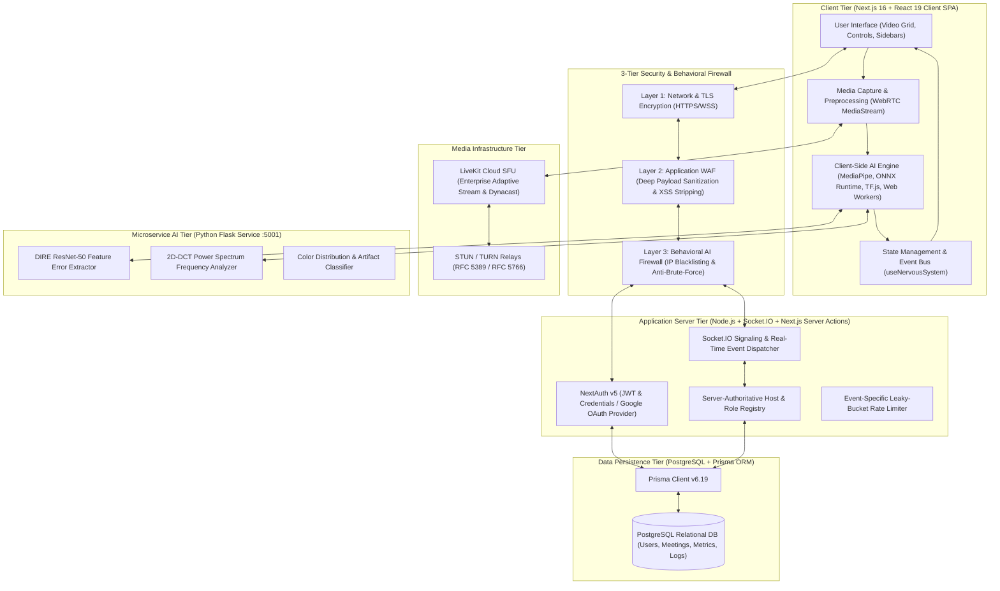
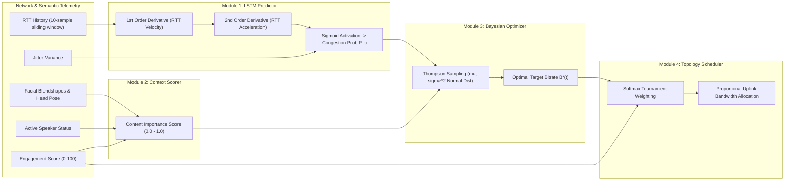
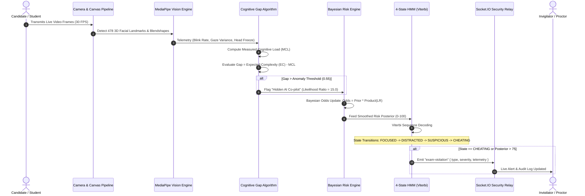

# ONLINE VIDEO MEETING: A STEP TOWARDS ATMA NIRBHAR BHARAT
## VTU Major Project Supporting Diagrams & Technical Schematics

### 1. Overall System Architecture

### 2. ARENA Bitrate & Congestion Optimization Architecture

### 3. CHRONOS Cognitive Gap & Exam Integrity Pipeline

