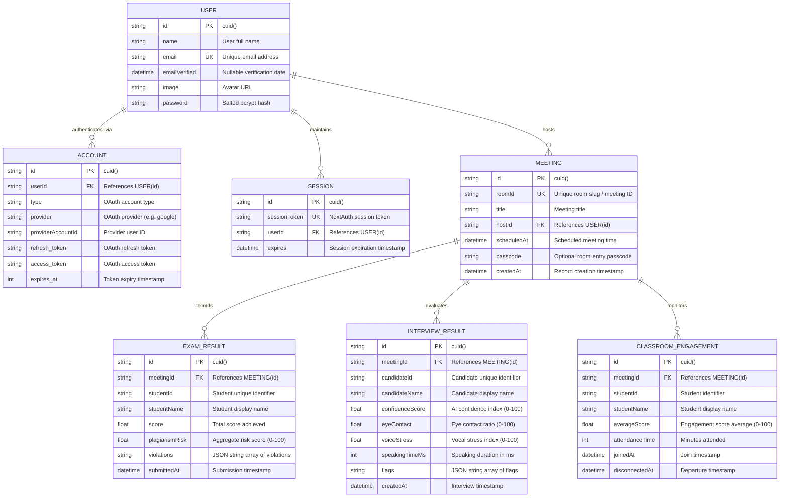

# Database Entity-Relationship Diagram (ERD) & Schema Specification
## Project: Online Video Meeting — A Step Towards Atma Nirbhar Bharat

### 1. Entity-Relationship Diagram (ERD)

### 2. Relational Integrity Rules
* **Cascading Deletions:** Deleting a `User` cascades to delete all associated `Account`, `Session`, and `Meeting` records (`onDelete: Cascade`).
* **Meeting Sub-Entities:** Deleting a `Meeting` cascades to purge all associated `ExamResult`, `InterviewResult`, and `ClassroomEngagement` records.
* **Unique Constraints:** Enforced on `User.email`, `Meeting.roomId`, `Session.sessionToken`, and compound unique on `[Account.provider, Account.providerAccountId]`.
