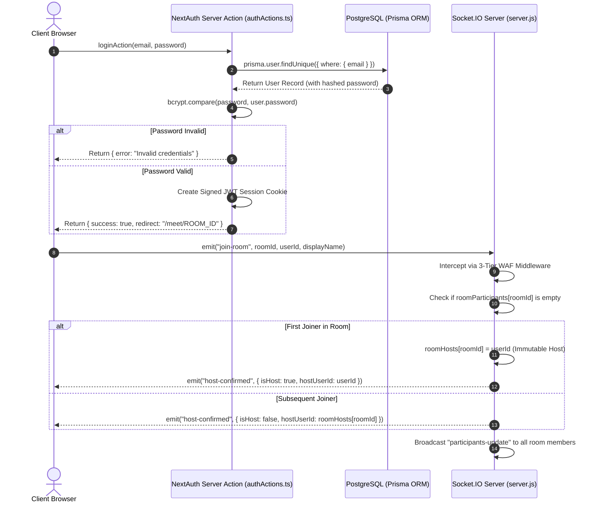
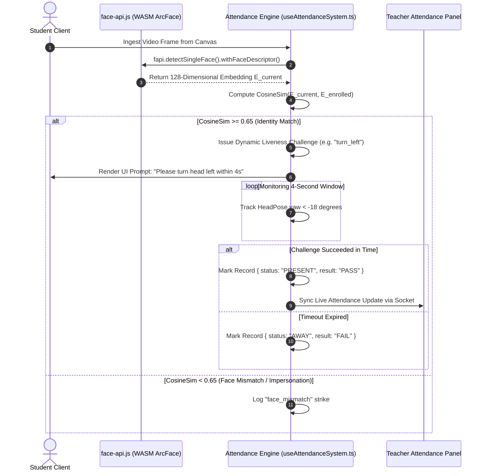

# Sequence Diagrams for Core Workflows
## Project: Online Video Meeting — A Step Towards Atma Nirbhar Bharat

### 1. User Authentication & Host Election Sequence


### 2. LiveKit SFU Dynacast Publishing & Subscription Sequence
```mermaid
sequenceDiagram
    autonumber
    actor Participant as Joining Participant
    participant API as Next.js API (/api/livekit/get-token)
    participant SFU as LiveKit Cloud SFU
    actor RemotePeer as Remote Room Subscriber

    Participant->>API: GET /api/livekit/get-token?room=ROOM_ID&username=USER_ID
    API->>API: Sign LiveKit AccessToken with API Secret & RoomGrant
    API-->>Participant: Return { token: JWT_STRING }

    Participant->>SFU: Room.connect(wss://livekit.cloud, token)
    SFU-->>Participant: Connection Established

    Participant->>Participant: navigator.mediaDevices.getUserMedia()
    Participant->>SFU: localParticipant.publishTrack(VideoTrack, { simulcast: true })
    Participant->>SFU: localParticipant.publishTrack(AudioTrack)

    SFU->>RemotePeer: emit(RoomEvent.TrackSubscribed, VideoTrack)
    RemotePeer->>RemotePeer: Render in DOM <video> element
    
    Note over RemotePeer,SFU: Remote Peer minimizes video tile to 180p size
    RemotePeer->>SFU: Send Dynacast Layer Hint (Request 180p spatial layer)
    SFU->>Participant: Adjust RTP transmission stream to lowest simulcast layer
```

### 3. Biometric ArcFace Verification & Challenge Liveness Sequence

