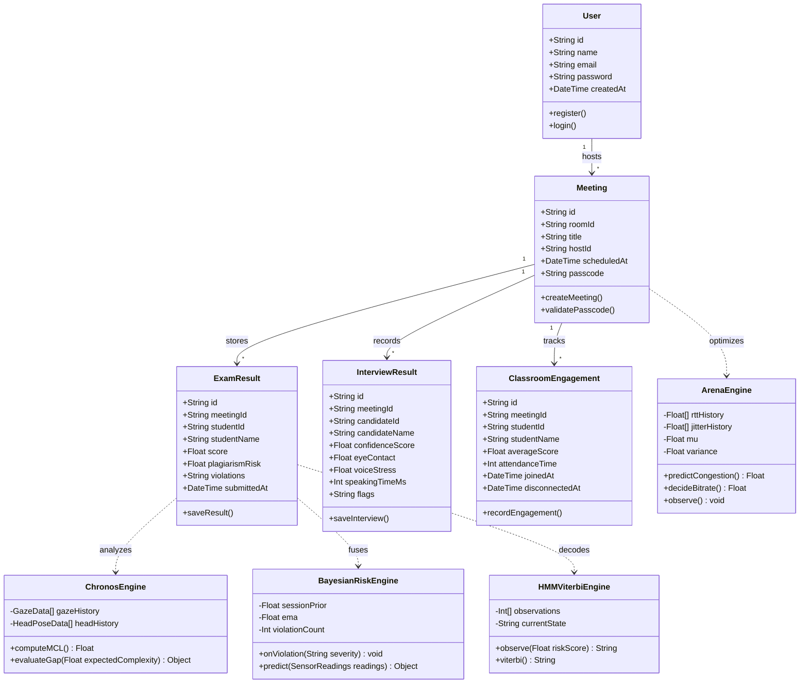
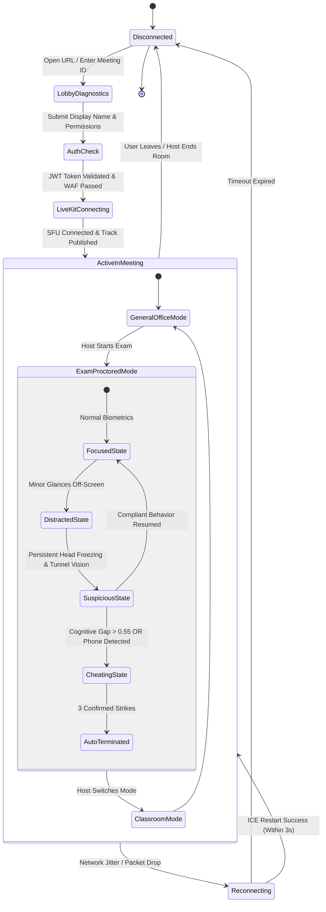

# UML Diagrams & Software Engineering Models
## Project: Online Video Meeting — A Step Towards Atma Nirbhar Bharat

### 1. Comprehensive System Use Case Diagram

```mermaid
graph TD
    subgraph Actors
        Host["Host / Proctor / Interviewer"]
        Participant["Participant / Student / Candidate"]
        Companion["Companion Mobile Device"]
        SystemAdmin["System Admin / Server"]
    end

    subgraph Authentication_Module["1. Authentication & Security"]
        UC1["User Registration (Credentials)"]
        UC2["User Login (NextAuth JWT / Google)"]
        UC3["Host Role Election & Verification"]
        UC4["3-Tier WAF Inspection & Rate Limiting"]
    end

    subgraph Conference_Module["2. Real-Time Media & Conference"]
        UC5["Create & Schedule Meeting (Room ID & Passcode)"]
        UC6["Join Meeting Lobby & Run Diagnostics"]
        UC7["Publish / Subscribe Audio & Video (LiveKit SFU)"]
        UC8["Toggle Mic, Camera & Virtual Background"]
        UC9["Share Screen with System Audio"]
        UC10["Multi-User Canvas Whiteboard"]
        UC11["Chat, Reactions & Upvotable Q&A"]
        UC12["Host Controls (Lock, Mute-All, Kick)"]
    end

    subgraph Smart_Modes_Module["3. Specialized AI Modes"]
        UC13["Smart Classroom (Engagement Heatmaps, AI Tutor)"]
        UC14["Interview Mode (Eye Contact, Voice Stress, Fluency)"]
        UC15["Exam Mode (CHRONOS AI Co-pilot Proctoring)"]
        UC16["Pair Secondary Angle via QR Code"]
        UC17["Biometric ArcFace Attendance & Liveness Challenge"]
    end

    subgraph Analytics_Module["4. Analytics & Document Generation"]
        UC18["Live Whisper ASR Transcription"]
        UC19["Export Gradebook & Minutes (PDF, DOCX, XLSX, VTT)"]
        UC20["D3.js Scam & Fraud Network Graph"]
    end

    Host --> UC1
    Host --> UC2
    Host --> UC5
    Host --> UC8
    Host --> UC9
    Host --> UC10
    Host --> UC11
    Host --> UC12
    Host --> UC13
    Host --> UC14
    Host --> UC15
    Host --> UC19
    Host --> UC20

    Participant --> UC1
    Participant --> UC2
    Participant --> UC6
    Participant --> UC7
    Participant --> UC8
    Participant --> UC9
    Participant --> UC10
    Participant --> UC11
    Participant --> UC15
    Participant --> UC17
    Participant --> UC18

    Companion --> UC16
    SystemAdmin --> UC3
    SystemAdmin --> UC4
```

### 2. Domain Class Diagram

### 3. State Transition Diagram: Participant & Proctoring Lifecycle

